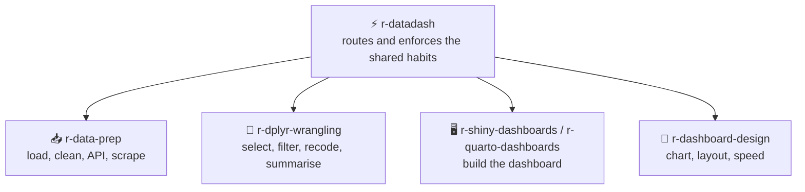

```
██████╗
██╔══██╗
██████╔╝
██╔══██╗
██║  ██║
╚═╝  ╚═╝

██████╗  █████╗ ████████╗ █████╗ ██████╗  █████╗ ███████╗██╗  ██╗
██╔══██╗██╔══██╗╚══██╔══╝██╔══██╗██╔══██╗██╔══██╗██╔════╝██║  ██║
██║  ██║███████║   ██║   ███████║██║  ██║███████║███████╗███████║
██║  ██║██╔══██║   ██║   ██╔══██║██║  ██║██╔══██║╚════██║██╔══██║
██████╔╝██║  ██║   ██║   ██║  ██║██████╔╝██║  ██║███████║██║  ██║
╚═════╝ ╚═╝  ╚═╝   ╚═╝   ╚═╝  ╚═╝╚═════╝ ╚═╝  ╚═╝╚══════╝╚═╝  ╚═╝

```

<div align="center">

# ⚡ R DataDash

**Skills that help an agent teach and build R dashboards, with the SQL and Power BI links around them, for students and lecturers.**

[](https://github.com/KinwiseNZ-DevOps/r-datadash/actions/workflows/validate.yml)
[](LICENSE)
[](https://agentskills.io)
[](https://agentskills.io/specification)
[](scripts/skills_tool.py)

</div>

Table of contents:

- [Skills](#skills)
- [How they fit together](#how-they-fit-together)
- [Install](#install)
- [Usage](#usage)
- [Optional agent profiles](#optional-agent-profiles)
- [Validate](#validate)
- [Layout](#layout)
- [Status and limits](#status-and-limits)

---

> [!IMPORTANT]
> **Principle: Every dashboard number must trace back to data the learner can inspect, and the agent explains the why, not only the code.**

The skills cover Shiny, bs4Dash and Quarto dashboards, data preparation, database links, statistics, chart design and Power BI modelling. They are grounded in the official Shiny, Quarto, DBI and Microsoft Learn documentation, plus MIT-licensed community material credited below, and follow the open [Agent Skills](https://agentskills.io/specification) format. They work in Claude Code, Codex, Cursor, Copilot, OpenCode, or any SKILL.md-compatible agent.

---

<a id="skills"></a>
## 🧩 Skills

<!-- catalogue:begin -->
| Skill | Purpose |
|---|---|
| [`powerbi-model-and-dax`](skills/powerbi-model-and-dax/SKILL.md) | Governs Power BI data models and DAX measures: star schema, relationships, date tables, storage modes, row-level security, and readable, fast DAX with variables and time intelligence. |
| [`r-dashboard-design`](skills/r-dashboard-design/SKILL.md) | Governs how a dashboard looks and performs: choosing a chart, arranging the page, colour and accessibility, labelling, and speed habits for R and Power BI dashboards. |
| [`r-data-prep`](skills/r-data-prep/SKILL.md) | Governs getting data ready for a dashboard in R: reading CSV, Excel and JSON, calling web APIs, scraping tables, cleaning, date handling, and the extract-transform- load script shape. |
| [`r-datadash`](skills/r-datadash/SKILL.md) | Router and shared guardrails for building, explaining and checking data dashboards with R, plus the SQL and Power BI links around them, aimed at students and lecturers. |
| [`r-dplyr-wrangling`](skills/r-dplyr-wrangling/SKILL.md) | Governs reshaping a data frame in R with dplyr before it feeds a dashboard. |
| [`r-quarto-dashboards`](skills/r-quarto-dashboards/SKILL.md) | Governs how to build and fix Quarto dashboards with R: the dashboard format, rows, columns, pages, tabsets, cards, sidebars, value boxes, and the optional Shiny server mode. |
| [`r-shiny-dashboards`](skills/r-shiny-dashboards/SKILL.md) | Governs how to build and fix Shiny and bs4Dash dashboards in R: file layout, global setup, ui and server split, reactivity, value boxes, tabs, charts and static assets. |
| [`r-sql-bridge`](skills/r-sql-bridge/SKILL.md) | Governs connecting R to a SQL database and handing data on to Power BI: DBI connections, safe credentials, reading and writing tables, parameterised queries, and choosing SQLite or PostgreSQL for teaching. |
| [`r-stats-foundations`](skills/r-stats-foundations/SKILL.md) | Governs the statistics behind dashboards in R: mean, median, mode, variance, standard deviation, skewness, correlation, hypothesis tests and simple linear regression, and how to explain a result in plain words. |
<!-- catalogue:end -->

---

<a id="how-they-fit-together"></a>
## 🗺️ How they fit together



Usually: data prep, then dplyr wrangling, then statistics (r-stats-foundations), then a dashboard tool, then design. r-sql-bridge and powerbi-model-and-dax join when a database or Power BI is involved.

---

<a id="install"></a>
## 📦 Install

> [!TIP]
> Install the router skill **plus every sibling skill it links to**; routers reference siblings by relative path.

**Claude Code plugin** (installs the skills and any agent profiles together):

```text
/plugin marketplace add KinwiseNZ-DevOps/r-datadash
/plugin install r-datadash@r-datadash-marketplace
```
**ChatGPT desktop plugin** (local, skills and bundled hooks):

This repo has a portable `plugin.json` manifest and a repo marketplace at `.agents/plugins/marketplace.json`. Open this repo as a trusted project and restart ChatGPT desktop, then install **R DataDash** from the Plugins Directory. Review and trust bundled hook scripts before they run.


Or copy or symlink the `skills/` subfolders you want into your agent's skills directory:

| Agent | Where skills live |
|---|---|
| Claude Code | `~/.claude/skills/` or a project's `.claude/skills/` |
| Codex · Cursor · Copilot · OpenCode · Windsurf | the agent's own SKILL.md discovery path |

To install supplied Claude Code, GitHub Copilot or Codex profiles into a project, run `python scripts/install_agents.py --host claude-code --target PATH`. Each repo supplies one main workflow agent and may supply one helper per host. Other hosts receive the skills only. If no profile files are supplied for that host, it makes no changes.

---

<a id="usage"></a>
## 🚀 Usage

> [!TIP]
> **You never need to memorise skill names.** Just describe the problem in plain words; the router picks the right skill automatically. But if you want short, reliable phrases that always work, use these:

**The flow** (this is all most people need):

```text
1. "Build me a Shiny dashboard from this CSV"     → Routes to the right skill and checks the result
2. "Explain what this test result means"    → Routes to the right skill and checks the result
3. "Review this dashboard for clarity"     → Routes to the right skill and checks the result
```

**Short phrases that trigger each skill:**

| Just say… | What you get | Skill used |
|---|---|---|
| `Why is my chart frozen?` | Finds the cause and fixes it with a check | *r-shiny-dashboards* |

> [!NOTE]
> Skills also trigger on their own when your request matches. In Claude Code you can also invoke one explicitly with `/<skill-name>`, but the plain phrases above are shorter and work across every agent.

---

<a id="optional-agent-profiles"></a>
## Optional agent profiles

This section applies only when agent definitions were supplied during setup. One main agent handles the repo's workflows through named modes, and an optional helper handles one distinct task. Profiles live under `resources/agents/<host>/`. Other hosts receive the skills only. If no agents were supplied, remove this section and let the skills run directly.

---

<a id="validate"></a>
## ✅ Validate

```bash
python scripts/skills_tool.py check
```

Checks: frontmatter, name/folder match, description length and trigger, body under 500 lines, every relative link resolves (including README.md and AGENTS.md), agent profile naming with no more than two profiles per host and exactly one `-workflow` main agent, agent `skills:` entries that exist and no `skills/<name>/SKILL.md` paths in agent bodies, plugin manifests (`.claude-plugin/plugin.json` and `marketplace.json`: required fields, licence matches `LICENSE`, `agents` lists every Claude Code profile, no top-level `agents/` folder), at least 3 eval cases per skill, catalogue freshness, no project-specific terms from `reference-content/strip-terms.txt`, and no em or en dashes in file names or in any text outside `reference-content/`. After the starter skill is deleted it also rejects leftover placeholders and setup-only paths that are tracked by Git or not ignored. Stdlib only, no dependencies.

---

<a id="layout"></a>
## 🗂️ Layout

<details>
<summary>Repository layout</summary>

```
skills/<name>/SKILL.md      one folder per skill (+ references/ where needed)
.claude-plugin/             plugin.json and marketplace.json (Claude Code plugin)
evals/cases.jsonl           3+ behavioural cases per skill
evals/triggers.jsonl        triggering tests per skill: obvious, paraphrase, unrelated
resources/agents/             optional host profiles copied by installer
scripts/install_agents.py     copy optional agent profiles into a project
scripts/skills_tool.py      validate, regenerate catalogue (stdlib only)
.github/workflows/          CI runs `skills_tool.py check` (free on public repos)
AGENTS.md                   agent-facing rules for this repo
SETUP.md                    local checklist; ignored and kept off GitHub
reference-content/          private source material; ignored and kept off GitHub
templates/                  local skill scaffolding; ignored and kept off GitHub
```

</details>

---

<a id="status-and-limits"></a>
## 📌 Status and limits

> [!NOTE]
> - Draft as of 18 October 2026: the skills are untested against live classroom use, and no skill covers Python or Tableau.
> - Power BI and PostgreSQL guidance is condensed from the MIT-licensed [awesome-copilot](https://github.com/github/awesome-copilot) collection.
> - Licensed under MIT (see [LICENSE](LICENSE)).

---

<div align="center">

**⚡ Built on the [Agent Skills](https://agentskills.io) open format · grounded in [Shiny](https://shiny.posit.co/r/), [Quarto](https://quarto.org/docs/dashboards/) and [Microsoft Learn](https://learn.microsoft.com/power-bi/)**

</div>
